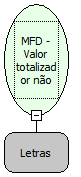

Descrição:

Retorna o valor acumulado em um determinado totalizador não fiscal.

Parâmetros:

1. Totalizador

Retorno:

Valor do totalizador

Nome Real:

ebfBematechFiscalMFDValueTotalizerNoFiscal

Compatibilidade:

Cliente
