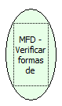

Descrição:

Retorna as formas de pagamento e seus valores acumulados.

Parâmetros:

Não possui

Retorno:

Formas de pagamento

Observação:

A impressora MFD permite programar até 20 formas de pagamento e essas formas não são mais apagadas na redução Z (conforme ocorria na impressora MP20 FI II). As formas que não estiverem programadas estarão com os valores zerados e a descrição em branco (veja exemplo acima).

Nome Real:

ebfBematechFiscalMFDPaymentForm

Compatibilidade:

Cliente
