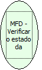

Descrição:

Retorna o estado da impressora.

Parâmetros:

Não possui

Retorno:

Lista de retorno

1. ACK

2. ST1

3. ST2

4. ST3

Observação:

Essa função devolve o status da impressora.

Nome Real:

ebfBematechFiscalMFDVerifyPrinterState

Compatibilidade:

Cliente
