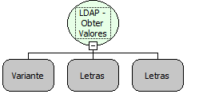

Descrição:

Obtém valores via LDAP. Deve ser passado o filtro que será executado e o tipo do retorno.

Parâmetros:

1. Conexão LDAP

2. Filtro a ser executado

3. Tipo de retorno

Retorno:

Lista de valores a partir do filtro e retorno passados.

Exemplo:

Obter Grupos

Filtro: (objectClass=group)

Retorno: name

Nome Real:

ebfLDAPGetValues

Compatibilidade:

Servidor
