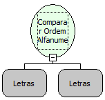

Descrição:

Essa função recebe dois valores e verifica se o primeiro valor é maior que o segundo (em ordem alfanumerica).

Parâmetros:

1. Nome ou expressão a ser verificada;

2. Nome ou expressão a ser verificada.

Retorno:

Lógico. Verdadeiro se o 1º Parâmetro é maior em ordem alfanumérica e Falso se for Menor ou Igual.

Observações:

1. Caso os valores sejam iguais, é retornado falso.

2. Essa função ignora letras maiúsculas e menúsculas.

Exemplo:

Utilizando os valores "Softwell" e "Maker", o retorno será "True", uma vez que "S" é maior que "M" na ordem alfanumerica.

Nome Real:

isGreaterIgCase

Compatibilidade:

Servidor
