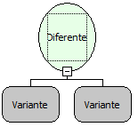

Descrição:

Essa função verifica se o 1º parâmetro é diferente do 2º parâmetro. Caso seja, retorna verdadeiro, caso contrário, falso.

Parâmetros:

1. Primeiro valor

2. Segundo valor

Retorno:

Retorna verdadeiro se o 1º parâmetro for diferente do 2º parâmetro, caso contrário retorna falso.

Exemplos:

1. Assumindo os parâmetros como 10 (inteiro) e 2 (Inteiro), o retorno seria verdadeiro.

2. Assumindo os parâmetros como A (letra) e A (letra), o retorno falso.

Observações:

1. Essa função diferencia letras maiúsculas e minúsculas.

2. Devido a tipagem dinâmica das variáveis na camada cliente. Para que a função considere que os parâmetros são numéricos, será necessário converter os valores para número (inteiro ou fracionario) ao passar os parâmetros para a função (mesmo se as variáveis utilizadas já forem numéricas).

Nome Real:

isDiferent

Compatibilidade:

Cliente e Servidor
