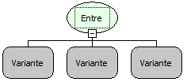

Descrição:

Essa função verifica se o valor passado no 1º parâmetro está contido no intervalo que é delimitado pelo 2º e 3º parâmetros. A depender do resultado, retorna verdadeiro ou falso.

Parâmetro:

1. Valor a ser verificado

2. Menor valor do intervalo

3. Maior valor do intervalo

Retorno:

Retorna verdadeiro se o valor verificado estiver no intervalo, caso contrário o retorno será falso.

Exemplos:

1. Assumindo que o valor do 1º parâmetro seja 50, o do 2º parâmetro 10 e o valor do 3º parâmetro 100 o retorno será verdadeiro, pois 50 está entre 10 e 100.

2. Assumindo que o valor do 1º parâmetro seja 5, o do 2º parâmetro 35 e o valor do 3º parâmetro 70 o retorno será falso, pois 5 não esta entre 35 e 70.

Nome Real:

oprBetween

Compatibilidade:

Cliente e Servidor
