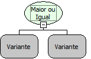

Descrição:

Essa função verifica se o valor do 1º parâmetro é maior ou igual a do 2º parâmetro. A depender do resultado retorna verdadeiro ou falso.

Parâmetros:

1. Valor a ser verificado

2. Valor a ser verificado

Retorno:

Retorna verdadeiro se o valor do 1º parâmetro for maior ou igual que o valor do 2º parâmetro, caso contrário o retorno será falso.

Exemplos:

1. Assumindo o valor do 1º parâmetro sendo 36 e o 2º parâmetro sendo 52 o valor de retorno será falso, pois 36 não é maior nem igual a 52.

2. Assumindo o valor do 1º parâmetro sendo 55 e o 2º parâmetro sendo 55 o valor de retorno será verdadeiro, pois a condição é maior ou igual e 55 é igual a 55.

Observação:

Devido a tipagem dinâmica das variáveis na camada cliente. Para que a função considere que os parâmetros são numéricos, será necessário converter os valores para número (inteiro ou fracionario) ao passar os parâmetros para a função (mesmo se as variáveis utilizadas já forem numéricas).

Nome Real:

isGreaterOrEqual

Compatibilidade:

Todas as camadas
