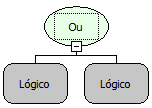

Descrição:

Essa função verifica se algum valor passado por parâmetro é verdadeiro, para retornar verdadeiro ou se todos os parâmetros são valores falsos, para retornar falso.

Parâmetros:

n. Recebe valores ou funções que retornem valores lógicos.

Retorno:

Retorna verdadeiro se apenas um parâmetro for verdadeiro e retorna falso se todos os parâmetros forem falsos.

Exemplos:

1. Assumindo que tenhamos dois parâmetros: o 1º recebe a função maior contendo os parâmetros: 3 e 5 (3&gt;5) e o 2º recebe a função menor contendo os parâmetros: 7 e 10 (7&lt;10), o retorno será verdadeiro,pois um parâmetro é verdadeiro.

2. Assumindo que tenhamos dois parâmetros: o 1º recebe a função igual contendo os parâmetros: A e F (A=F) e o 2º recebe a função diferente contendo os parâmetros: 64 e 64 (64&lt;&gt;64), o retorno será falso, pois as duas condições são falsas.

Nome Real:

oprOr

Compatibilidade:

Todas as camadas
