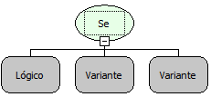

Descrição:

Essa função verifica o valor lógico do 1º parâmetro, se o mesmo for verdadeiro o retorno será o valor que estiver no 2º parâmetro, caso contrário o valor do 3º parâmetro.

Parâmetros:

1. Função que tenha um retorno lógico

2. Valor a ser retornado caso o primeiro parâmetro seja verdadeiro

3. Valor a ser retornado caso o primeiro parâmetro seja falso

Retorno:

Retorna o valor do 2º parâmetro ou do 3º parâmetro a depender do retorno lógico do 1º parâmetro.

Exemplos:

1. Assumindo que o valor do 1º parâmetro seja a função igual contendo os valores 7 e 7 (7=7), o 2º parâmetro o valor 7 e o 3º parâmetro o valor 5, o retorno será 7, pois a condição do 1º parâmetro é verdadeira.

2. Assumindo que o valor do 1º parâmetro seja a função diferente contendo os valores 19 e 19 (19&lt;&gt;19), o 2º parâmetro o valor 35 e o 3º parâmetro a função soma contendo 5 e 15 (5+15) , o retorno será o resultado da soma no caso 20, pois a condição do 1º parâmetro é falsa.

Nome Real:

oprIf

Compatibilidade:

Todas as camadas
