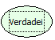

Descrição:

Retorna o valor lógico verdadeiro.

Parâmetros:

Não possui

Retorno:

O Retorno será verdadeiro.

Exemplos:

1. Utilizando a função igual contendo no 1º parâmetro a constante lógica true e o 2º parâmetro a função Verdadeiro o retorno será verdadeiro, pois verdadeiro é igual a verdadeiro.

2. Utilizando a função Diferente contendo no 1º parâmetro a constante lógica false e o 2º parâmetro a função verdadeiro o retorno será verdadeiro, pois falso é diferente de verdadeiro.

Nome Real:

oprTrue

Compatibilidade:

Todas as camadas
