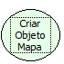

Descrição:

Criar um mapa ou um mapeamento para armazenar valores, com uma diferença: ambos os valores (chave e valor) são Strings. (É interessante saber que um Mapa associa os dois objetos: passando uma chave, então se obtém um valor).

Parâmetros:

Não possui.

Retorno:

Retorna o objeto mapa. O retorno pode ser armazenado numa variável do tipo variante

Nome Real:

ebfMapCreateObject

Compatibilidade:

Cliente e Servidor
