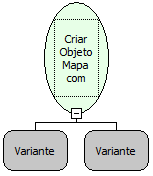

Descrição:

Essa função criar um mapa ou mapeamento para armazenar valores a partir de uma lista de "par/valor".

Parâmetros:

1. Lista com "par/valor".

2. Lista com "par/valor".

Retorno:

Retorna o objeto mapa com suas chaves e seus respectivos valores. O retorno pode ser armazenado numa variável do tipo variante.

Observação:

A função pode ter (N) parâmetros.

Exemplo:

Assumindo o 1º e 2º parâmetro sendo a Função Criar Lista a partir dos parâmetros contendo os pares de valores: Maker/Flow e Softwell/Freire. O retorno será um objeto mapa contendo esses elementos.

Nome Real:

ebfMapCreateFromList

Compatibilidade:

Cliente e Servidor
