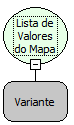

Descrição:

Essa função obtém todos os valores de um determinado objeto mapa.

Parâmetros:

1. Objeto Mapa

Retorno:

Retorna uma lista de valores. O retorno deverá ser armazenado numa variável do tipo variante.

Exemplo:

Assumindo o 1º parâmetro contendo um objeto mapa com as seguintes chaves e respectivos valores: Maker/Flow; Freire/Softwell, Banco/SQL. A partir desses valores o retorno será uma lista com os valores do objeto mapa, que seria Flow, Softwell e SQL.

Nome Real:

ebfMapValues

Compatibilidade:

Cliente e Servidor
