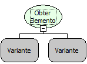

Descrição:

Essa função obtém o elemento de um objeto mapa a partir da chave (ou Referência).

Parâmetros:

1. Objeto Mapa

2. Chave (ou Referência)

Retorno:

Retorna o elemento de um determinado objeto mapa a partir da chave (ou referência) do elemento. O retorno deverá ser armazenado em uma variável do tipo variante.

Exemplo:

Assumindo o 1º parâmetro contendo um objeto mapa com as seguintes chaves e respectivos valores: Maker/Flow; Freire/Softwell, Banco/SQL e o 2º parâmetro contendo a chave Maker. A partir desses valores o retorno será o valor "Flow".

Nome Real:

ebfMapGetObject

Compatibilidade:

Cliente e Servidor
