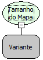

Descrição:

Essa função retorna a quantidade de valores que existe no objeto mapa.

Parâmetros:

1. Objeto Mapa

Retorno:

Retorna o tamanho do objeto mapa, ou seja, a quantidade de valores que existe no mapa. O retorno pode ser armazenado numa variável do tipo Inteiro.

Exemplo:

Assumindo o 1º parâmetro contendo um objeto mapa com as seguintes chaves e respectivos valores: Maker/Flow; Freire/Softwell, Banco/SQL. A partir desses valores o retorno será 3, pois existe 3 valores no objeto mapa que são Flow, Softwell e SQL.

Nome Real:

ebfMapLength

Compatibilidade:

Cliente e Servidor
