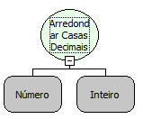

Descrição:

Essa função é utilizada para fazer o arredondamento de valores por casas decimais. O número será arredondado para cima ou para baixo a depender do valor das casas decimais. Caso o valor das casas decimais seja maior ou igual a 0,5 o número será arredondado para baixo, caso contrário, para cima.

Parâmetros:

1. Número a ser arredondado.

2. Quantidade de casas decimais, para a qual o número será arredondado.

Retorno:

Retorna o número fracionado passado por parâmetro com as casas decimais arredondadas.

Exemplo:

1.  Assumindo o Parâmetro 1 como: 9,5782, e o Parâmetro 2 como: 2 (Inteiro), o retorno seria: 9,58.

2.  Assumindo o Parâmetro 1 como: 9,5566, e o Parâmetro 2 como: 2 (Inteiro), o retorno seria: 9,56.

Observações:

Para garantir a integridade das operações matemáticas, utilize conversão para o tipo de dado nos parâmetros.

Nome Real:

ebfArredondaDecimal

Compatibilidade:
