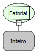

Descrição:

O Fatorial de um número natural n é o produto de todos os inteiros positivos menores ou iguais a n.

Isso é escrito como n! e lido como "fatorial de n ".

Parâmetros

1. Valor (n)

Retorno:

Fatorial do valor determinado.

Exemplo:

Assumindo o Parâmetro 1 como 5 o retorno seria 120.

Observação:

Para garantir a integridade das operações matemáticas, utilize conversão para o tipo de dado nos parâmetros.

Nome Real:

ebfMathFactorial

Compatibilidade:

Cliente e Servidor
