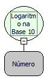

Descrição:

Calcula o logaritmo na base 10 de um valor.

Parâmetros:

1. Valor para cálculo (logaritmando).

Retorno:

Logaritmo na base 10 do valor determinado.

Exemplo:

Assumindo o Parâmetro 1 como 86 o retorno seria 1,934498451

Observação:

Para garantir a integridade das operações matemáticas, utilize conversão para o tipo de dado nos parâmetros.

Nome real:

ebfMath10Logarithm

Compatbilidade:

Cliente e Servidor
