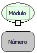

Descrição:

Calcula o valor absoluto de um número, ou seja, retorna sempre o valor positivo.

Parâmetros:

1. Valor para retornar um valor absoluto.

Retorno:

Módulo do número passado por parâmetro.

Exemplo:

Assumindo o Parâmetro 1 como -10 (Inteiro), o retorno seria 10 (Inteiro).

Observação:

Para garantir a integridade das operações matemáticas, utilize conversão para o tipo de dado nos parâmetros.

Nome Real:

oprModulus

Compatibilidade:

Todas as camadas
