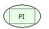

Descrição:

Obtém o valor de PI.

Parâmetros:

Não possui.

Retorno:

Retorna o valor de PI (3,14...)

Observação:

Para garantir a integridade das operações matemáticas, utilize conversão para o tipo de dado nos parâmetros.

Nome Real:

ebfMathPI

Compatibilidade:

Cliente e Servidor
