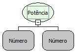

Descrição:

Eleva o coeficiente passado no Parâmetro 1, ao expoente passado no Parâmetro 2.

Parâmetros:

1. Valor a ser elevado à potência (coeficiente).

2. Valor para ser informado como expoente.

Retorno:

Retorna o valor calculado.

Exemplo:

Assumindo os parâmetros como 4 (Inteiro) e 2 (Inteiro), o retorno seria: 16.0 (Fracionado).

Observação:

Para garantir a integridade das operações matemáticas, utilize conversão para o tipo de dado nos parâmetros.

Nome Real:

oprPow

Compatibilidade:

Todas as camadas
