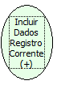

Descrição:

Inclui os dados como um novo registro no banco e fica novamente em modo de inserção para um novo cadastro.

Parâmetros:

Não possui.

Retorno:

Não possui.

Observação:

O uso dessa função tem uma melhor performance quando usada em regras clientes.

Nome Real:

ebfNavIncludeMoreSaveRecord

Compatibilidade:

Todas as camadas
