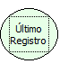

Descrição:

Vai para o último registro do formulário corrente.

Parâmetros:

Não possui.

Retorno:

Não possui.

Observação:

O uso dessa função tem uma melhor performance quando usada em regras clientes.

Nome Real:

ebfNavLastRecord

Compatibilidade:

Todas as camadas
