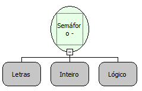

Descrição:

Adquire um semáforo a partir de um identificador. Essa função bloqueia uma ocorrência por tempo indeterminado e recebe um valor lógico que define se apenas o proprietário do semáforo pode liberá-lo.

Parâmetros:

1. Identificador único para representação do semáforo

2. Tempo de espera para adquirir o semáforo (em milisegundos).

3. Define se apenas o proprietário do semáforo pode liberá-lo

Retorno:

Retorna identificador dono do Semáforo.

Observação:

A função tentará adquirir o semáforo até o tempo máximo especificado no 2º parâmetro. Caso não consiga, retornará uma exceção.

Nome Real:

ebfSemaphoreAcquire

Compatibilidade:

Servidor
