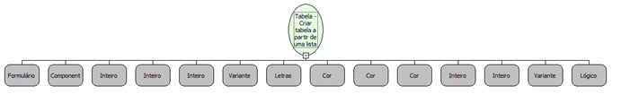

Descrição:

Cria uma tabela a partir de uma lista de listas

Parâmetros:

1. Formulário

2. Moldura

3. Largura da tabela (Opcional)

4. Altura da tabela (Opcional)

5. Tamanho da borda da tabela (Opcional)

6. Lista de listas de elementos

7. Alinhamento (Opcional)

    Valores aceitos:

       + left (Esquerda)

       + center (Centro)

       + right (Direita)

8. Cor de fundo da tabela (Opcional)

9. Cor da borda da tabela (Opcional)

10. Cor de fundo da célula (Opcional)

11. Espaçamento entre as células (Opcional)

12. Espaçamento entre o texto e as bordas da célula (Opcional)

13. Estilo das células (Opcional) Ex: "background-color: #000000"

14. Barra de Rolagem (Opcional)

Retorno:

Não possui.

Nome Real:

ebfHTMLTableCreateWithArray

Compatibilidade:

Cliente e Servidor
