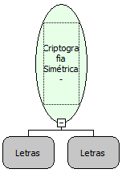

Descrição:

Criptografa a mensagem utilizando uma chave com uma criptografia simétrica.

Parâmetros:

1. Mensagem a ser criptografada

2. Chave

Retorno:

Mensagem Criptografada

Nome Real:

ebfMessageSymmetricEncrypt

Compatibilidade:

Servidor
