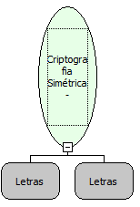

Descrição:

Decriptografa a mensagem utilizando uma chave com uma criptografia simétrica

Parâmetros:

1. Mensagem Criptografada

2. Chave

Retorno:

Mensagem Decriptografada

Nome Real:

ebfMessageSymmetricDecrypt

Compatibilidade:

Servidor
