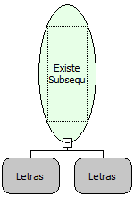

Descrição:

Esta função procura dentro do 1° parâmetro a subseqüência passada no 2º parâmetro.

Parâmetros:

1. Texto onde será feita a pesquisa.

2. Valor a ser localizado.

Retorno:

Retorna verdadeiro se encontrar a subseqüência ou falso caso não encontre.

Exemplos:

1. Assumindo os parâmetros como 'Maker'(Letras), e 'Ma '(Letras) , o retorno seria verdadeiro.

2. Assumindo os parâmetros como 'Maker'(Letras), e 'Ja '(Letras) , o retorno seria falso.

Nome Real:

ebfSearchSubstring

Compatibilidade:

Todas as camadas
