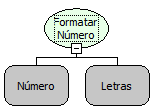

Descrição:

Formata um número de acordo com uma máscara.

Parâmetros:

1. Número

2. Máscara

Retorno:

Número formatado (Letras)

Observação:

Deve ser seguido os padrões da classe. Para mais informações sobre as máscaras acesse:

http://java.sun.com/j2se/1.4.2/docs/api/java/text/DecimalFormat.html

Nome Real:

ebfFormatNumber

Compatibilidade:

Servidor
