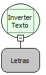

Descrição:

Inverte o texto passado por parâmetro.

Parâmetros:

1. Texto a ser invertido.

Retorno:

Retorna o texto invertido(Letras).

Exemplo:

Assumindo como parâmetro a palavra "Maker"; (Letras), o retorno seria "rekaM".

Nome Real:

ebfStringReverse

Compatibilidade:

Cliente e Servidor
