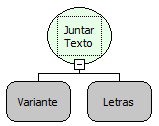

Descrição:

Transformar uma Lista(conjunto de valores) em um Texto separando cada elemento com um delimitador(separador)

especificado no 2º parâmetro.

Parâmetros:

1. Objeto Lista.

2. Separador entre os elementos da lista.

Retorno:

Retorna os elementos da lista passada (1° parâmetro) separados pelo conteúdo do 2º parâmetro (Letras).

Exemplos:

1. Assumindo os parâmetros como  uma lista com 2 elementos ("Maker" e "Flow" ) e "|"(Letras), o retorno seria "Maker|Flow" (Letras).

2. Assumindo os parâmetros como  uma lista com 3 elementos ("ABC" ,"DEF" e "GHI") e  nulo (Letras) no segundo parâmetro, o retorno seria "ABCDEFGHI" (Letras).

Nome Real:

ebfListImplode

Compatibilidade:

Cliente e Servidor
