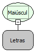

Descrição:

Transforma o texto passado como parâmetro para  minúsculo.

Parâmetros:

1. Texto a ser transformado.

Retorno:

Converte o texto passado no primeiro parâmetro para  letras minúsculas e retorna.

Exemplos:

1. Assumindo o parâmetro como "MAKER FLOW" (Letras),  o retorno seria "maker flow".

2. Assumindo o parâmetro como "Maker Flow" (Letras),  o retorno seria "maker flow".

Nome Real:

ebfToLowerCase

Compatibilidade:

Cliente e Servidor
