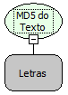

Descrição:

Retorna o Md5/Digest de um texto passado como parâmetro. O digest é  constituído de 32 caracteres de 0-9,A-F, cada par de caracteres é a representação hexadecimal dos 16 números inteiro que formam o MD5 Digest.

Parâmetros:

1. Texto a ser transformado.

Retorno:

MD5 Digest do texto passado como parâmetro.

Observação:

Para saber mais sobre o assunto pesquise em um site de busca sobre "MD5" ou "The MD5 Message-Digest Algorithm".

Nome Real:

ebfTextMD5

Compatibilidade:

Servidor
