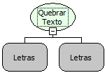

Descrição:

Separa o texto em um determinado caractere passado no 2° parâmetro e retorna cada parte deste texto em uma posição

de uma lista.

Parâmetros:

1. Texto que será quebrado.

2. Caractere.

Retorno:

Retorna uma lista com o texto separado (Lista).

Exemplo:

Assumindo os parâmetros como "M,A,K,E,R,F,L,O,W" (Letras), e "," (Letras),  o retorno será uma lista com 09 elementos contendo "M"|"A"|"K"|"E"|"R"|"F"|"L"|"O"|"W" respectivamente.

Nome Real:

ebfSplit

Compatibilidade:

Cliente e Servidor
