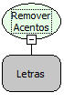

Descrição:

Remove acentos do texto passado por parâmetro

Parâmetros:

1. Texto (Letras)

Retorno:

Texto sem acentos (Letras)

Exemplo:

àèìòùáéíóúâêîôûãõçñäëïöüÀÈÌÒÙÁÉÍÓÚÂÊÎÔÛÃÕÇÑÄËÏÖÜ

Sera retornado isto:

aeiouaeiouaeiouaocnaeiouAEIOUAEIOUAEIOUAOCNAEIOU

Nome Real:

ebfRemoveAccents

Compatibilidade:

Cliente e Servidor
