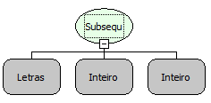

Descrição:

A função recebe um texto (1º parâmetro) e retorna uma subsequência deste texto. A subsequência inicia na posição

indicada no 2º parâmetro, com o tamanho indicado no 3º parâmetro.

Parâmetros:

1. Texto

2. Posição inicial da subsequência que se deseja obter.

3. Quantidade de caracteres da subsequência.

Retorno:

Retorna a subsequência contida no texto(Letras) passado no 1º parâmetro, que inicia na posição informada no 2º parâmetro, e contém o número de caracteres informado no 3º parâmetro.

Exemplo:

Assumindo como parâmetros "Fluxo de ações" (Letras), 2 (Inteiro) e 10(Inteiro). O retorno será "luxo de aç".

Nome Real:

ebfSubstring

Compatibilidade:

Todas as camadas
