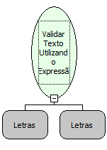

Descrição:

Essa função faz uma validação numa string utilizando expressão regular.

Parâmetros:

1.  Recebe o texto que será validado pela expressão regular.

2.  Recebe a expressão regular para validar o texto.

Retorno:

Lógico

Observação:

Os retornos podem ser:

- True  - O texto informado é válido, segundo a expressão regular informada.
- False - O texto informado não é válido.

Nome Real:

ebfValidateTextER

Compatibilidade:

Cliente e Servidor
