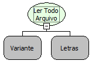

Descrição:

Lê todo o conteúdo do arquivo passado no parâmetro, mesmo que tenha quebra de linha definindo o charset.

Parâmetros:

1. Variável onde a referência do arquivo foi armazenada. Essa referência é o retorno da função "Abrir arquivo para

leitura";

2. Charset a ser utilizado. Ex: iso-8859-1, utf-8

Retorno:

Conteúdo de todo o arquivo (Letras).

Observação:

Antes de utilizar essa função, é necessário utilizar a função "Abrir arquivo para leitura" (Categoria arquivo).

Exemplo:

1.Assumindo como parâmetro a referência para um arquivo que tem o texto "Maker ALL" , o retorno será "Maker ALL".

Nome Real:

ebfFileReadContentWithCharset

Compatibilidade:

Servidor
