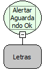

Descrição:

Exibe uma mensagem de alerta junto com um botão "Ok"  e o fluxo só continua a ser executado após o usuário clicar neste botão.

Parâmetros:

1. Mensagem que será exibida.

Exemplo:

Assumindo como parâmetro a mensagem "Maker ALL", junto com este aparecerá um botão de OK. O fluxo só continuará sendo executado quando o usuário clicar no botão.

Nome Real:

ebfAlertMessage

Compatibilidade:

Cliente e Servidor
