Descrição:

Chama um WEB service (são componentes que permitem às aplicações enviar e receber dados em formato XML).

Parâmetros:

1. URL do Web Service (Sempre com http:// antes)

2. Porta

3. Nome do Método

4. Variante

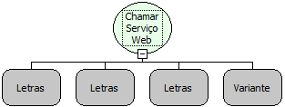

Retorno:

Variante

Exemplo:

[Clique aqui](../../../../../dicas_e_truques/maker/exemplo_de_utilizacao_de_web_services_no_maker).

Observação:

Quando o serviço web que será chamado for um fluxo de ação marcado como "Externo" no "Gerenciador de "Objetos" do Maker, os parâmetros da lista criada para o quarto parâmetro desta função deverão ser do tipo "Letras".

Nome Real:

ebfWSCall

Compatibilidade:

Servidor

Exemplo de utilização de Web Services no Maker

Resumo

A Função utilizada para este recurso é:

- Chamar Serviço Web (Chama o Serviço da Web de acordo com os parâmetros passados).

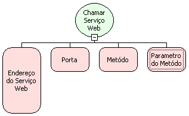

Parâmetros

1º - Endereço do Serviço Web (tipo Letras)

2º - Porta do Serviço Web (tipo Letras)

3º - Nome do Metóto (tipo Letras)

4º - Parâmetro Necessário para utilização do Serviço Web (tipo Variante)

Retorna uma Variante.

Exemplo:

Parâmetros

1º - http://www.byjg.com.br/xmlnuke-php/webservice.php/ws/cep?WSDL

2º - CEPServicePort

3º - obterLogradouro

4º - 11111111 (CEP)

Retorno

Logradouro do CEP passado como parâmetro.

Visualize um exemplo prático e passo a passo

Neste exemplo, será consumido um Web Services no Maker. Iremos tomar como exemplo um formulário de cadastro de clientes e um Web Service (de terceiros) que obtém o logradouro a partir de um CEP informado. Ao preencher o CEP no formulário, o endereço  será obtido automaticamente e o campo endereço será preenchido.

O primeiro passo - é a criação do formulário no Maker.

1. Vamos assumir que o formulário de Clientes esteja criado e funcionando;

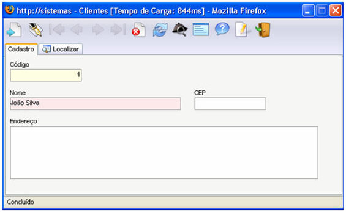

O segundo passo - criar um fluxo que irá obter o valor do campo CEP e preencher o campo endereço:

1. Acesse o Editor de Fluxo de Ações;
2. Crie um Identificador (variável):

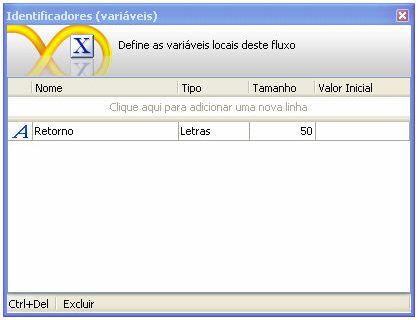

3. Crie um Parâmetro de Entrada para receber o valor digitado no campo CEP:

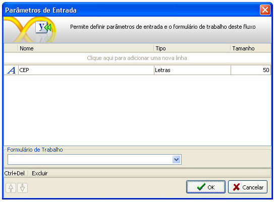

4. Crie a seguinte estrutura de fluxo inserindo dois objetos do tipo Processamento e documente como mostra a figura abaixo:

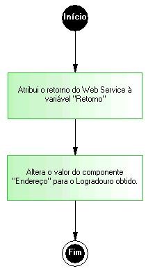

5. Para o primeiro objeto Processamento, será utilizada a função Chamar Serviço Web, que faz parte da categoria Utilitário. Essa função utiliza-se de quatro parâmetros:

- O primeiro parâmetro: determina o endereço do WSDL do Web Service. Clicando sobre o primeiro parâmetro da função, na tela Propriedades, selecione o Tipo Letras e determine o endereço http://www.byjg.com.br/xmlnuke-php/webservice.php/ws/cep?WSDL:

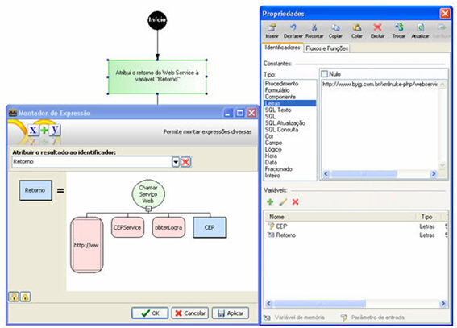

- O segundo parâmetro: determina a porta do Web Service. Clicando sobre o segundo parâmetro da função, na tela Propriedades, selecione o Tipo Letras e determine CEPServicePort.:

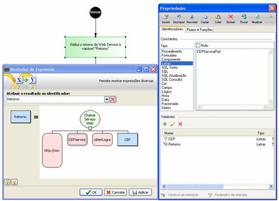

- O terceiro parâmetro: do método que será chamado no Web Service. Neste caso é o método que obtém o Logradouro a partir do CEP. Clicando sobre o terceiro parâmetro da função, na tela Propriedades, selecione o Tipo Letras e determine obterLogradouro:

- O quarto parâmetro: este é o parâmetro que o método do Web Service irá receber. No caso do método obterLogradouro, o parâmetro é o CEP do logradouro, que foi atribuído ao componente da tela anteriormente. Caso o método do Web Service receba n parâmetros, pode-se passar um objeto lista contendo-os. Clicando sobre o quarto parâmetro da função, na tela Propriedades, selecione a Variável CEP:

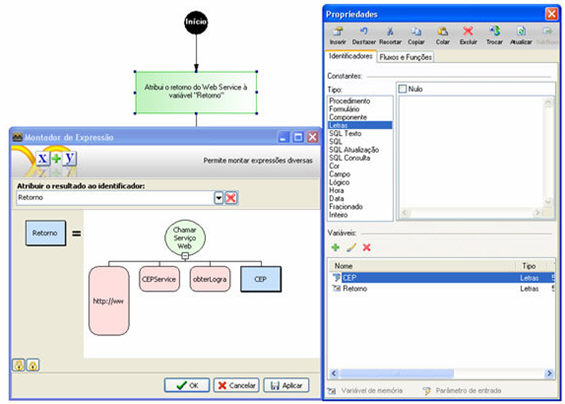

6. Agora, utilizando o campo Atribuir o resultado ao identificador, selecione Retorno (então atribua o retorno do processamento à variável). Clique no botão ;
7. Para o segundo objeto Processamento, será utilizada a função Alterar Valor do Componente , que faz parte da categoria Formulário. Ocorrerá a alteração do valor do componente que corresponde ao endereço do Cliente no formulário, inclusive passando como parâmetro a variável Retorno, que irá conter o Logradouro que foi retornado pelo Web Service.. Esta função utiliza-se de três parâmetros:

- O primeiro parâmetro: determina o nome do formulário, na aba Identificadores, Componente do Tipo Formulário, utilizando o campo ao lado:

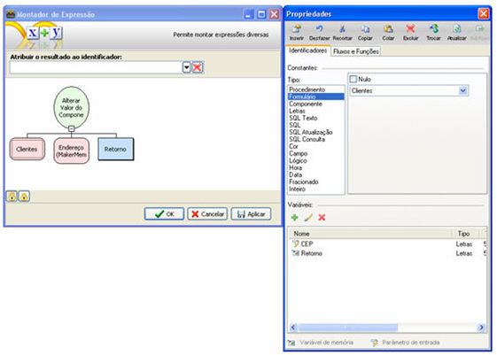

- O segundo parâmetro: determina o nome do componente do formulário, que será preenchido pelo valor obtido. Da aba Identificadores, selecione o Tipo Componente e no campo ao lado, selecione o campo endereço do seu formulário:

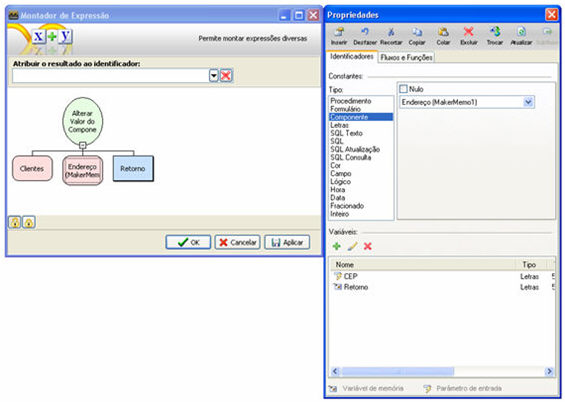

- O terceiro parâmetro: determina o valor do campo que será preenchido. Neste caso definiremos a variável Retorno:

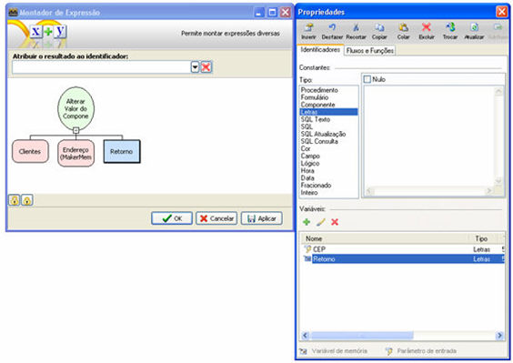

8. Clique no botão ;
9. Feche o Editor de Fluxo de Ações.

- O terceiro passo - agora basta ligar o fluxo ao Evento Ao Sair do componente CEP do formulário:

1. Selecione o campo CEP do formulário;
2. Clique direito do mouse sobre o campo, posicione o mouse em Eventos;
3. Na opção Ao Sair, clique no botão ;
4. Na tela Ações, na opção Executar Regra de negócio, selecione abaixo o Nome do fluxo. No campo Entrada é necessário criar um parâmetro chamado CEP do tipo Letras e atribuí-lo ao componente CEP da tela (no caso CEP=&#123;edtCEP&#125;). Deve-se observar que edtCEP é o nome do componente do campo CEP no formulário.

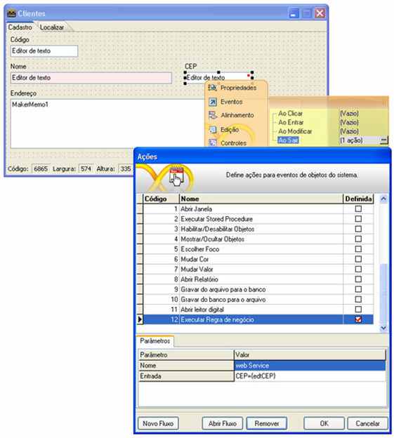

5. Após isto, salve o formulário;
6. Acesse o sistema na Web;
7. Atualize o formulário;
8. Ao preencher o CEP, na tela, o Endereço é preenchido automaticamente:
