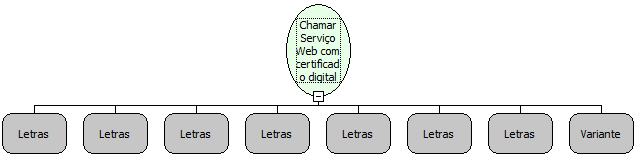

Descrição:

Faz uma chamada a um webservice utilizando protocolo HTTPS

Parâmetros:

1. Arquivo com as informações sobre os certificados do serviço

2. Senha para o arquivo com as informações sobre os certificados do serviço

3. Arquivo com o certificado de quem chama o serviço

4. Senha para o arquivo com o certificado de quem chama o serviço

5. URL do Web Service (Sempre com https:// antes)

6. Porta

7. Nome do Método

8. Variante (Parâmetros do método)

Retorno:

Conteúdo do XML retornado pelo webservice.

Nome Real:

ebfWSCallSSL

Compatibilidade:

Servidor
