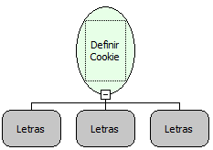

Descrição:

Define um valor de um Cookie.

Parâmetros:

1. Nome do cookie definido.

2. Valor do cookie.

3. Comentário.

Retorno:

Não possui.

Exemplo:

1.°Parâmetro: senhaUsuarios

2.°Parâmetro: 123

3.°Parâmetro: Senha de um usuário logado em uma

Observações:

1. Existe uma função "Obter valor de um Cookie" que permite obter o cookie criado por essa função.

2. Esta função está homologada apenas com os servidores de aplicações "TomCat" e "JBoss".

Nome Real:

ebfSetCookie

Compatibilidade:

Cliente e Servidor
