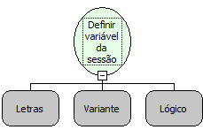
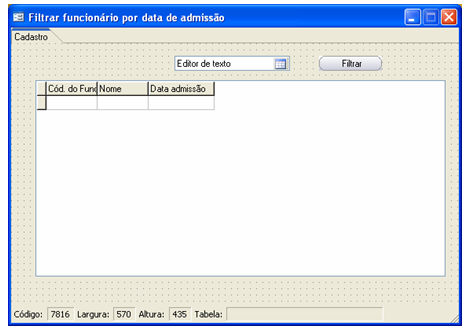
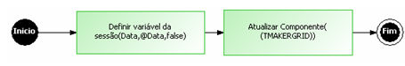
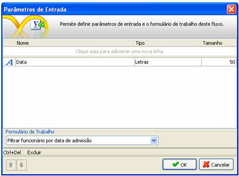
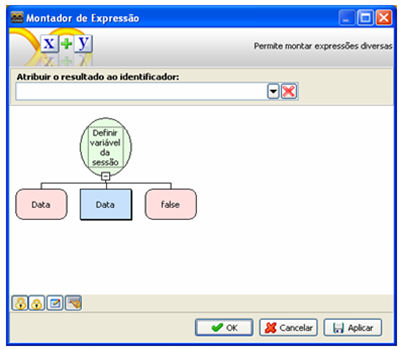
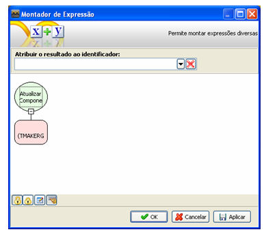
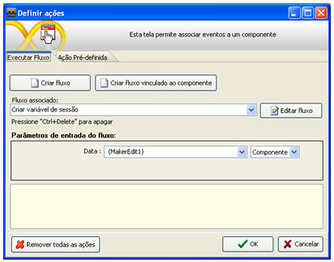
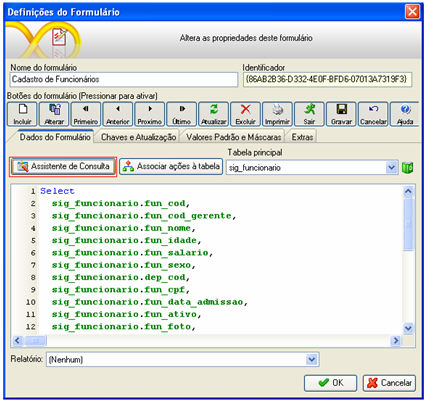
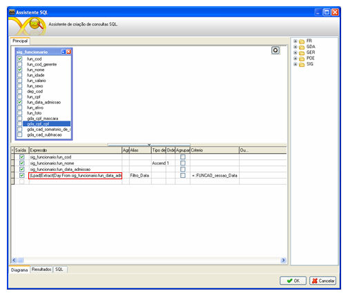
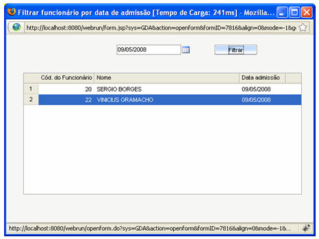

Descrição:

As variáveis de sessão são utilizadas quando houver a necessidade de ter uma variável que se mantém para regras diferentes. Variáveis de sessão não globais se mantém de acordo com o usuário e as globais se mantém para todo usuário. Se for necessário, por exemplo, guardar a hora de login de um usuário para ser utilizada em várias regras diferentes, essa variável de sessão será local. Se for necessário, por exemplo, guardar a quantidade de usuários logados, essa variável de sessão será global.

Parâmetros:

1. Nome da variável.

2. Valor a ser armazenado.

3. Escopo da variável. Recebe verdadeiro(se ela vai ser global) ou falso (não global - exclusiva do usuário atual).

Retorno:

Retorna o antigo valor da variável. Caso a variável não exista, retorna Nulo.

Exemplo:

Assumindo como parâmetros: Contador (Letras),6 (Inteiro) e Verdadeiro (Lógico), quando a função for executada vai ser criada uma varável global chamada Contador com o conteúdo 6.

Observações:

1. Ao definir a variável, é recomendável não alterar o tipo de variável esperado no valor (Variante). Utilize as funções de conversão          somente no momento em que for obter o valor da variável definida anteriormente.

2. Não é possível definir variáveis que contenham Consultas como valor.

3. Não é possível utilizar as funções de lista e Mapa para guardar variáveis na sessão com fluxo cliente.

4. As funções que acessam variáveis de sessão são: "Obter variável da Sessão" e "Remover variável da Sessão".

5. As variáveis de sessão definidas num fluxo do tipo cliente não tem a opção de escopo global ou local, sempre que definidas, tais variáveis tem escopo local, de modo que o terceiro parâmetro desta função pode ser desconsiderado.

6. Filtragem de relatórios por variável de sessão. Caso exista uma variável de sessão com o formato REPORT_FILTER_&lt;campo do filtro do relatório&gt;, o sistema preenche automaticamente o filtro.

7. Para definir variável de sessão em formulário externos, o fluxo deve estar na camada servidor.

Nome Real:

ebfSetSessionAttribute

Compatibilidade:

Cliente e Servidor

Filtrando um campo do tipo data por uma variável de sessão

Esse exemplo demonstra de maneira prática como filtrar um campo do tipo data por uma variável de sessão.

1. Crie um formulário com as seguintes características:

2. Criação do fluxo:

Para facilitar o raciocínio o fluxo ficará da seguinte forma:

1. Defina o seguinte parâmetro de entrada

2. Adicione um processamento e utilize a seguinte função: Definir variável de sessão.

3. Adicione um processamento e utilize a função: Atualizar Componente.

4. Associe o fluxo ao botão Filtrar do formulário e em Parâmetros de entrada do fluxo, selecione o componente MakerEdit1.

3. Definindo a consulta SQL.

1. Clique sobre o componente Grade do formulário e selecione Definições e em seguida Assistente de Consulta.

A consulta ficará da seguinte forma:

1 - (Lpad(Extract(Day From sig_funcionario.fun_data_admissao), 2, '0') || '/' || Lpad(Extract(Month From sig_funcionario.fun_data_admissao), 2, '0') || '/' || Extract(Year From sig_funcionario.fun_data_admissao)). Conteúdo do campo selecionado em vermelho.

Observação: O select irá variar para cada tipo de banco utilizado. No exemplo o banco utilizado é o Postgres.

4. Salve o formulário e execute-o no Webrun.

