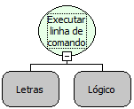

Descrição:

Executa uma linha de comando no "SHELL" do SERVIDOR, retornando o resultado.

Parâmetros:

1. Linha de comando a ser executada.

2. Caso deseje que o fluxo só continue apenas após acabar o comando defina como verdadeiro, caso contrário, defina como falso.

Retorno:

Resultado do comando executado (Letras)

Exemplo:

Uma função assumindo como parâmetros  "cmd /c mkdir c:/softwell" (Letras) e Falso (Lógico). Esse exemplo cria uma pasta com o nome softwell.

Observações:

1. Se o 2° parâmetro estiver verdadeiro, o fluxo só vai continuar após terminar de executar o comando.

2. O comando é executado somente no servidor.

3. Caso o comando executado não possua retorno, será retornado nulo.

Nome Real:

ebfShellExecute

Compatibilidade:

Servidor
