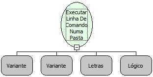

Descrição:

Executa uma linha de comando no "SHELL" do SERVIDOR.

Parâmetros:

1. Comando a ser exceutado e seus argumentos (Lista).

2. Lista contendo variáveis de ambiente a serem utilizadas para executar o comando.

3. Pasta onde será executado o comando ou Nulo para executar no diretório corrente.

4. Caso deseje que o fluxo só continue apenas após acabar o comando defina como verdadeiro, caso contrário, defina como falso.

Retorno:

Resultado do comando executado (Letras)

Observações:

1. Se o 4° parâmetro estiver verdadeiro, o fluxo só vai continuar após terminar a execução do comando.

2. O comando é executado somente no servidor.

3. Uma vez definido o parâmetro 4 como Verdadeiro, o resultado do comando será retornado. Caso contrário, retornará Nulo.

4. O diretório corrente é em relação ao servidor de aplicações.

Nome Real:

ebfShellExecuteAtFolder

Compatibilidade:

Servidor
