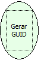

Descrição:

A função gera um GUID e o retorna. GUID significa - Globally Unique Identifier (Identificador Único Universal). Como não existem dois GUIDs idênticos, não importa quantos são gerados, eles servem para identificar de forma única senhas, manipuladores, chaves, etc.

Parâmetros:

Não Possui.

Retorno:

GUID (Identificador Único Universal). Pode ser armazenado em uma variável do tipo Letras.

Exemplo:

Ao gerar um GUID, o retorno seria "648AAF7A-EB32-F348-EB9D-C6FD0A15D78B".

Nome Real:

ebfGenerateGUID

Compatibilidade:

Servidor
