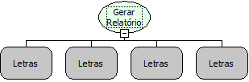

Descrição:

Gera o relatório solicitado sendo que o mesmo não será impresso na tela do usuário. Após criado o relatório, a função retornará o caminho absoluto do arquivo gerado.

Parâmetros:

1. Nome ou código do relatório a ser gerado

2. Tipo do relatório a ser gerado.

3. Filtro a ser executado no relatório a ser gerado. Para mais de um filtro, separe com ponto e vírgula (;). (Verificar Observação)

4. Ordenação do relatório a ser gerado. Defina 1 para ascendente e 0 para descendente. Separe com pipe, vide exemplo.

Retorno:

Caminho absoluto do arquivo gerado.

Observações:

1. Caso o relatório tenha sido feito no RB7, deve ser utilizado o filtro no formato tabela.campo=valor.

2. No caso de gerar um relatório RB10, os parâmetros devem ser utilizados no formato nome_do_parametro=valor;

3. Caso o relatório possua o filtro between (Entre), deve ser utilizada ao fim a expressão _copy.

Exemplo: Data_Pagamento_copy=14/11/1987,14/11/2009; As datas devem ser separadas por vírgula e o copy deve ser todo minúsculo.

Exemplo:

Parâmetro 1: Relatório de Teste

Parâmetro 2: PDF, HTM, SCR (Tela), TXT, XLS

Parâmetro 3: CIDADE.NOME=Salvador;CIDADE.UF=BA (RB7) | cidade=Salvador;estado=BA (RB10)

Parâmetro 4: CIDADE.NOME|0;CIDADE.UF|1

Nome Real:

ebfReportGeneration

Compatibilidade:

Servidor
