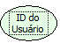

Descrição:

A função retorna o código do usuário do sistema contido na tabela FR_USUARIO.

Parâmetros:

Não possui.

Retorno:

Retorna o código do usuário conectado ao sistema (Tabela FR_USUARIO).

Exemplo:

Se o usuário for Master, o retorno será 1(Inteiro).

Nome Real:

ebfGetUserCode

Compatibilidade:

Servidor
