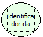

Descrição:

Quando o usuário conecta ao sistema, uma sessão é gerada com um identificador único, essa função tem como objetivo retornar o identificador da sessão do usuário conectado ao sistema.

Parâmetros:

Não possui

Retorno:

Retorna o identificador da sessão do usuário conectado ao sistema. (Letras)

Nome Real:

ebfGetSessionID

Compatibilidade:

Servidor
